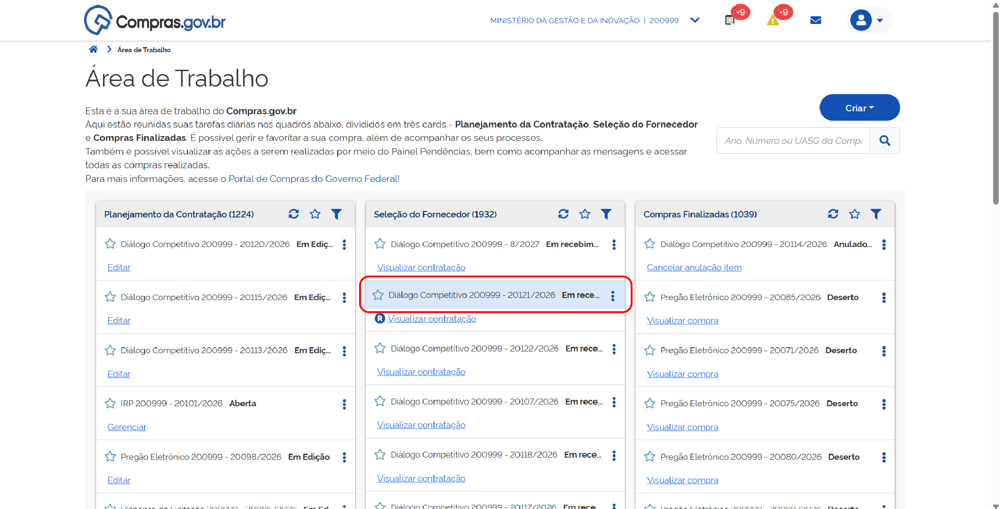
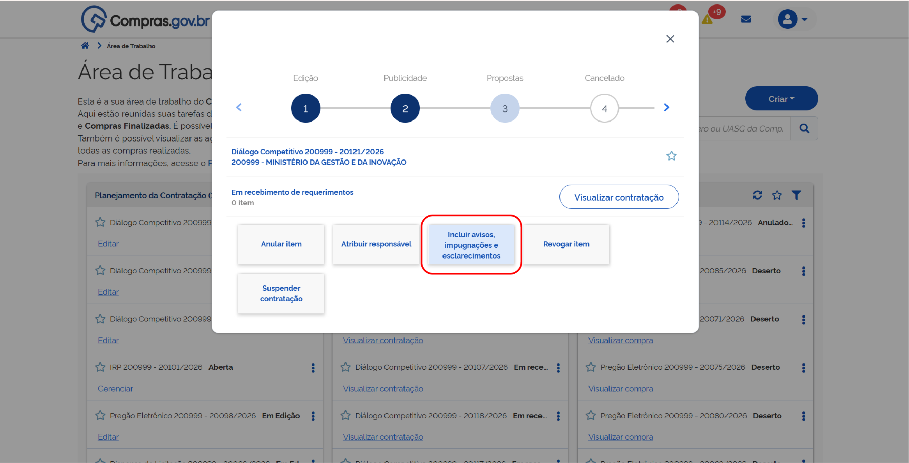
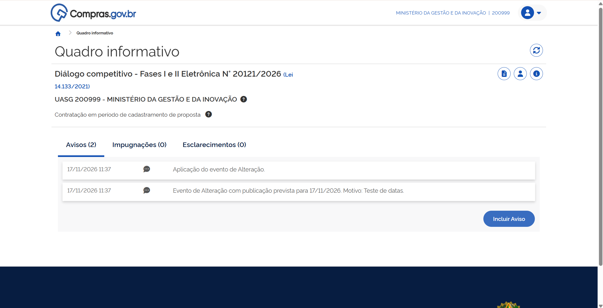
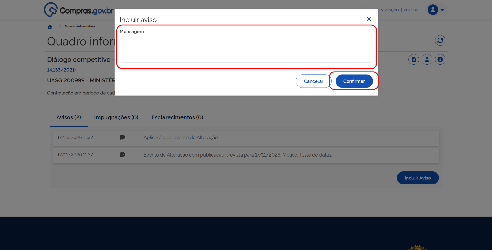
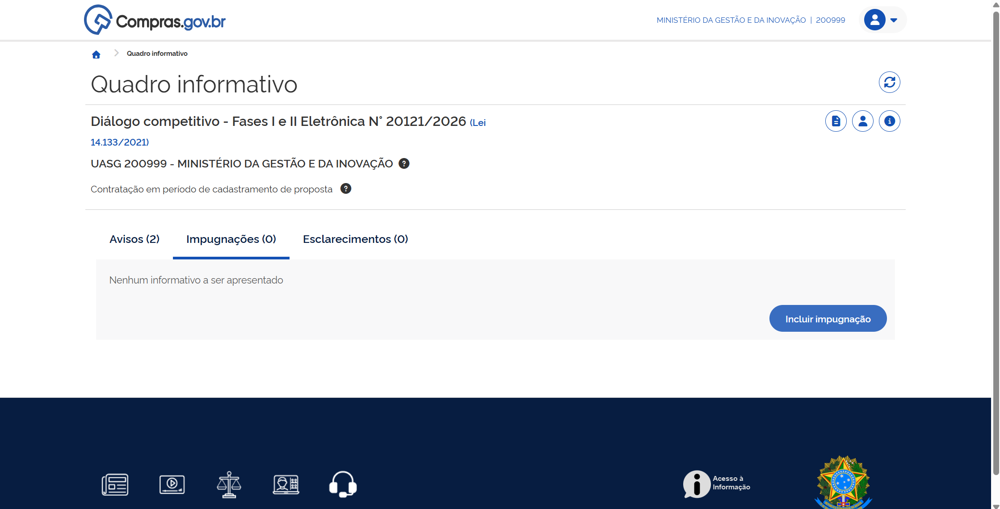
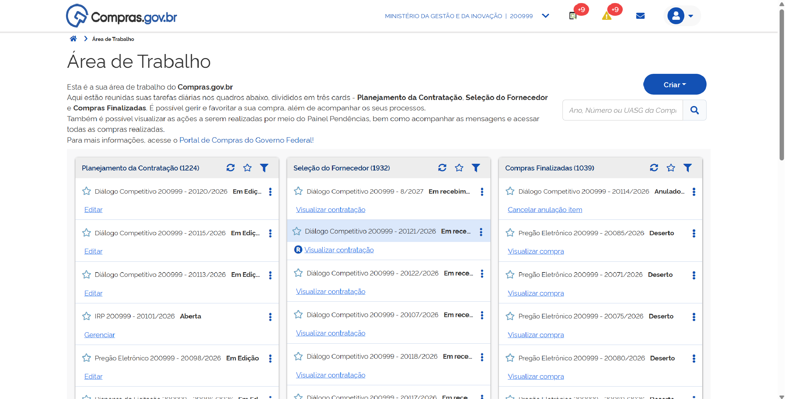
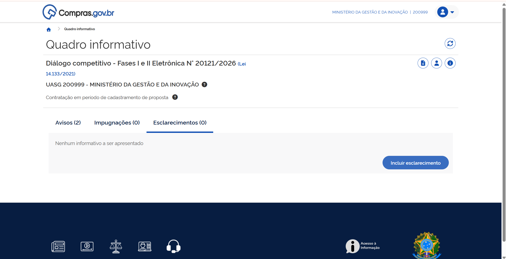
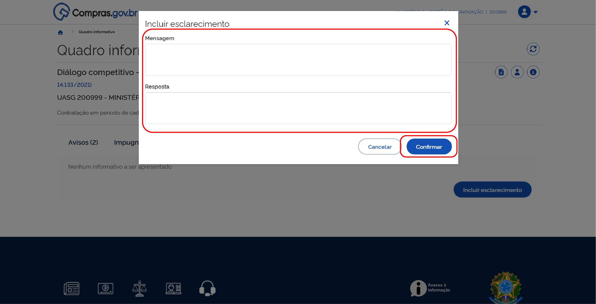

  Tamanho do texto:
  <button onclick="diminuirFonte()" title="Diminuir texto" style="padding: 6px 12px; font-weight: bold; cursor: pointer; border: 1px solid #ccc; border-radius: 4px; background: #f8f9fa;">A-</button>
  <button onclick="resetarFonte()" title="Tamanho normal" style="padding: 6px 12px; font-weight: bold; cursor: pointer; border: 1px solid #ccc; border-radius: 4px; background: #f8f9fa;">A</button>
  <button onclick="aumentarFonte()" title="Aumentar texto" style="padding: 6px 12px; font-weight: bold; cursor: pointer; border: 1px solid #ccc; border-radius: 4px; background: #f8f9fa;">A+</button>
  <button onclick="window.print()" style="background-color: #0056b3; color: white; padding: 6px 16px; border: none; border-radius: 5px; font-size: 14px; cursor: pointer; box-shadow: 0 2px 4px rgba(0,0,0,0.2); margin-left: 10px;">
    🖨️ Imprimir ou baixar esta página
  </button>

# 3. AVISOS, IMPUGNAÇÕES E ESCLARECIMENTOS

Após a divulgação da contratação, é possível registrar avisos, impugnações e pedidos de esclarecimentos diretamente pelo sistema.

## Avisos

**Passo 01:** Para publicar avisos sobre o evento de contratação, localize-a na **Área de Trabalho do usuário Governo** e clique sobre o número que a identifica.

**Passo 02:** Selecione a opção “Incluir avisos, impugnações e esclarecimentos”.

**Passo 03:** Na aba **Avisos**, clique em “Incluir Aviso”.

**Passo 04:** Preencha o campo destacado na imagem abaixo e clique em **Confirmar**.

!!! warning "Atenção"
   Avisos não podem ser excluídos.

---

## Impugnações

**Passo 01:** Para publicar impugnações relativas ao evento de contratação, localize-a na **Área de Trabalho do usuário Governo** e clique sobre o número que a identifica.

**Passo 02:** Selecione a opção “Incluir avisos, impugnações e esclarecimentos”.

**Passo 03:** Na aba **Impugnações**, clique em “Incluir impugnação”.

**Passo 04:** Preencha os campos destacados na imagem abaixo e clique em **Confirmar**.

!!! warning "Atenção"
    Impugnações não podem ser excluídas.

---

## Esclarecimentos

**Passo 01:** Para publicar pedidos de esclarecimentos sobre a contratação, localize-a na **Área de Trabalho do usuário Governo** e clique sobre o número que a identifica.

**Passo 02:** Selecione a opção “Incluir avisos, impugnações e esclarecimentos”.

**Passo 03:** Na aba **Esclarecimentos**, clique em “Incluir esclarecimento”.

**Passo 04:** Preencha o campo destacado na imagem abaixo e clique em **Confirmar**.

!!! warning "Atenção"
    Esclarecimentos não podem ser excluídos.

 

  <button onclick="window.print()" style="background-color: #0056b3; color: white; padding: 10px 20px; border: none; border-radius: 5px; font-size: 16px; cursor: pointer; box-shadow: 0 2px 4px rgba(0,0,0,0.2);">
    🖨️ Imprimir ou baixar esta página
  </button>

