

  Tamanho do texto:
  <button onclick="diminuirFonte()" title="Diminuir texto" style="padding: 6px 12px; font-weight: bold; cursor: pointer; border: 1px solid #ccc; border-radius: 4px; background: #f8f9fa;">A-</button>
  <button onclick="resetarFonte()" title="Tamanho normal" style="padding: 6px 12px; font-weight: bold; cursor: pointer; border: 1px solid #ccc; border-radius: 4px; background: #f8f9fa;">A</button>
  <button onclick="aumentarFonte()" title="Aumentar texto" style="padding: 6px 12px; font-weight: bold; cursor: pointer; border: 1px solid #ccc; border-radius: 4px; background: #f8f9fa;">A+</button>
  <button onclick="window.print()" style="background-color: #0056b3; color: white; padding: 6px 16px; border: none; border-radius: 5px; font-size: 14px; cursor: pointer; box-shadow: 0 2px 4px rgba(0,0,0,0.2); margin-left: 10px;">
    🖨️ Imprimir ou baixar esta página
  </button>

# 4. ANULAÇÃO E REVOGAÇÃO DE ITEM

Nesta seção, você confere como realizar a anulação ou a revogação do item da contratação, bem como os procedimentos para cancelar essas ações quando necessário.

## Anular item

**Passo 01:** Para anular o item da contratação, localize-a na **Área de Trabalho do usuário Governo** e clique sobre o número que a identifica.

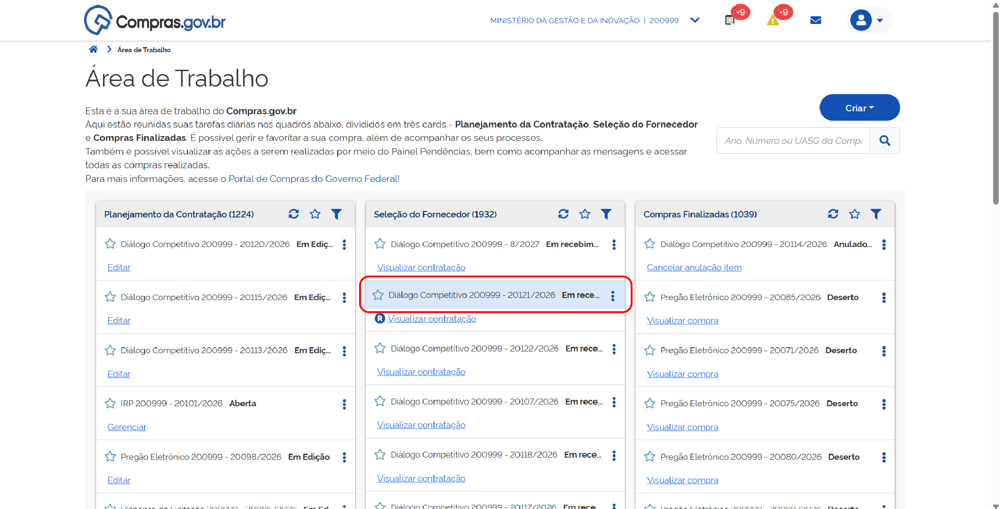

**Passo 02:** Selecione a opção “Anular item”.

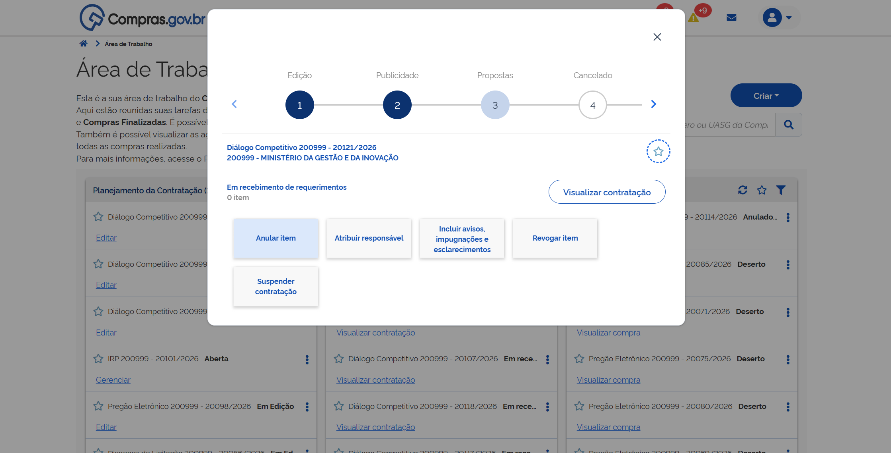

**Passo 03:** Na tela de anular ou revogar itens, localize o item da contratação

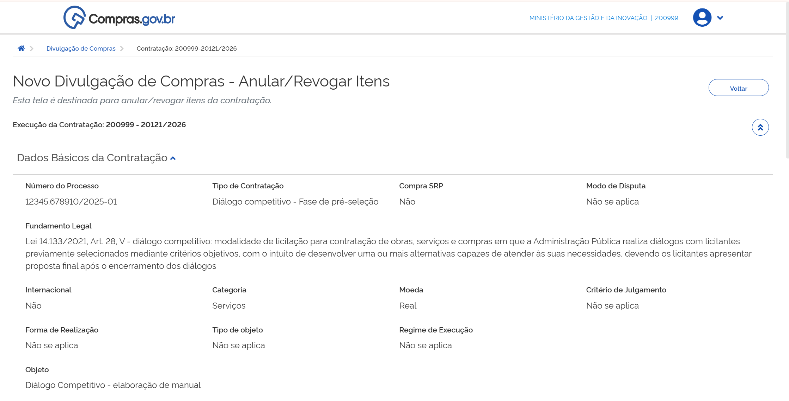

e clique no botão “Anular/revogar”.

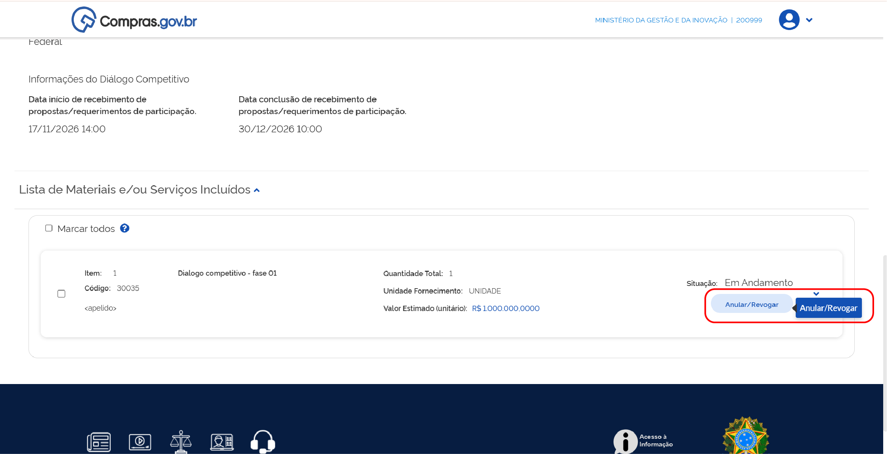

**Passo 04:** Escolha a opção “Anulação de item”.

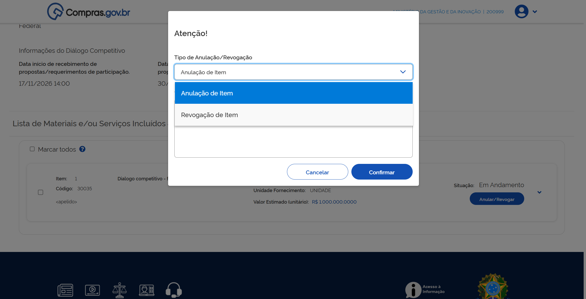

**Passo 05:** Preencha a justificativa e confirme a opção.

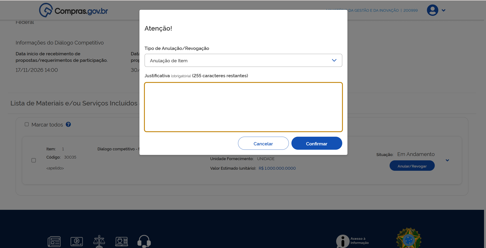

O item será anulado.

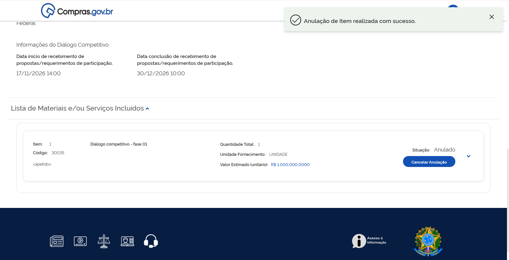

!!! warning "Atenção"
    **Atenção:** Por ser uma contratação de único item, o procedimento de anulação do item resultará na anulação do processo de contratação.

---

## Cancelamento da anulação

**Passo 01:** Para cancelar a anulação do item, localize a contratação na **Área de Trabalho do usuário Governo** e clique sobre “Cancelar anulação de item”.

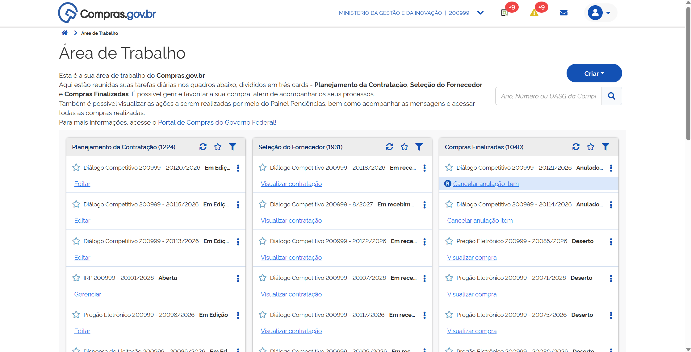

**Passo 02:** Na tela de anular ou revogar itens, localize o item da contratação

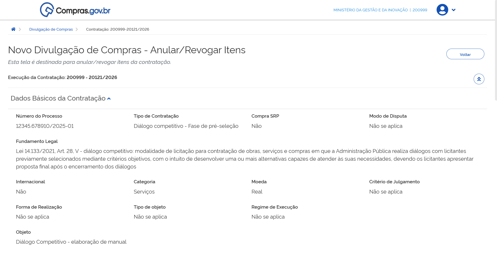

e clique em “Cancelar anulação”.

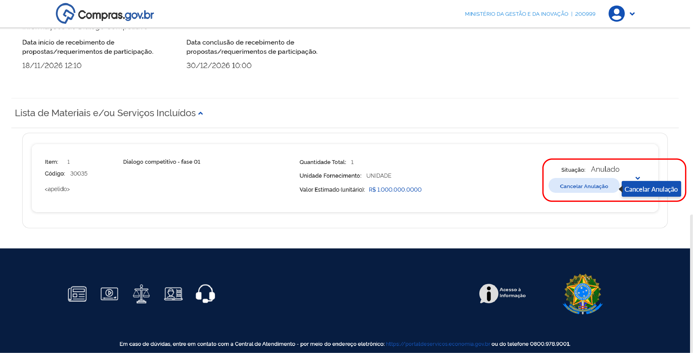

**Passo 03:** Preencha as informações destacadas na imagem abaixo e confirme.

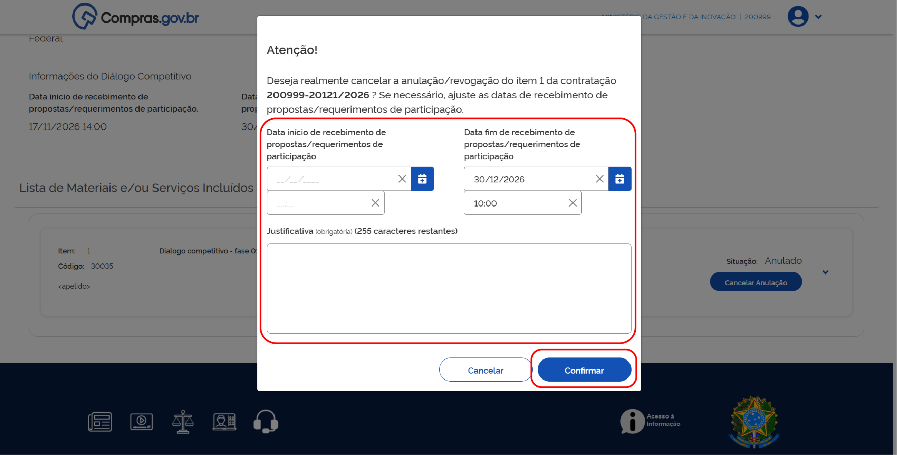

A anulação do item será cancelada.

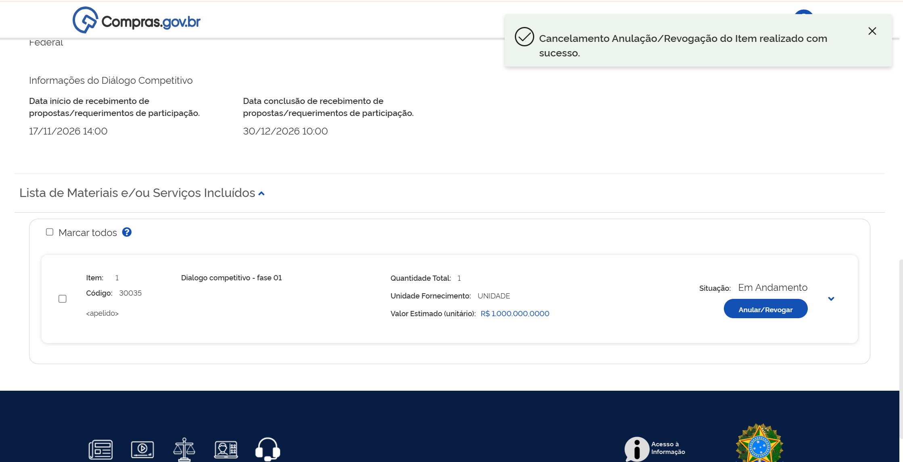

---

## Revogar item

**Passo 01:** Para revogar o item, localize a contratação na **Área de Trabalho do usuário Governo** e clique sobre o número que a identifica.

**Passo 02:** Selecione a opção “Revogar item”.

**Passo 03:** Na tela de anular ou revogar itens, localize o item da contratação

e clique no botão “Anular/revogar”.

**Passo 04:** Selecione a opção “Revogação de item”.

**Passo 05:** Preencha a justificativa e confirme a opção.

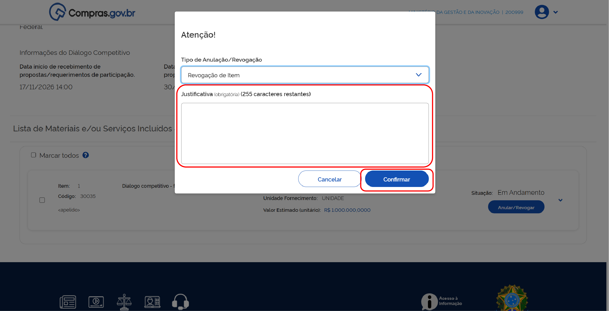

O item será revogado.

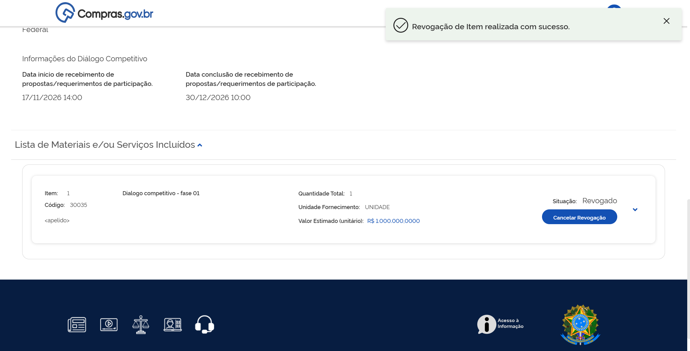

!!! warning "Atenção"
    **Atenção:** Por ser uma contratação de único item, o procedimento de revogação do item resultará na revogação do processo de contratação.

---

## Cancelamento de revogação

**Passo 01:** Para cancelar a revogação do item, localize sua contratação na **Área de Trabalho do usuário Governo** e clique sobre “Cancelar revogação de item”.

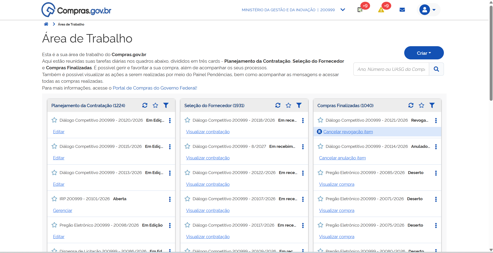

**Passo 02:** Na tela de anular ou revogar itens, localize o item da contratação

e acione o botão “Cancelar revogação”.

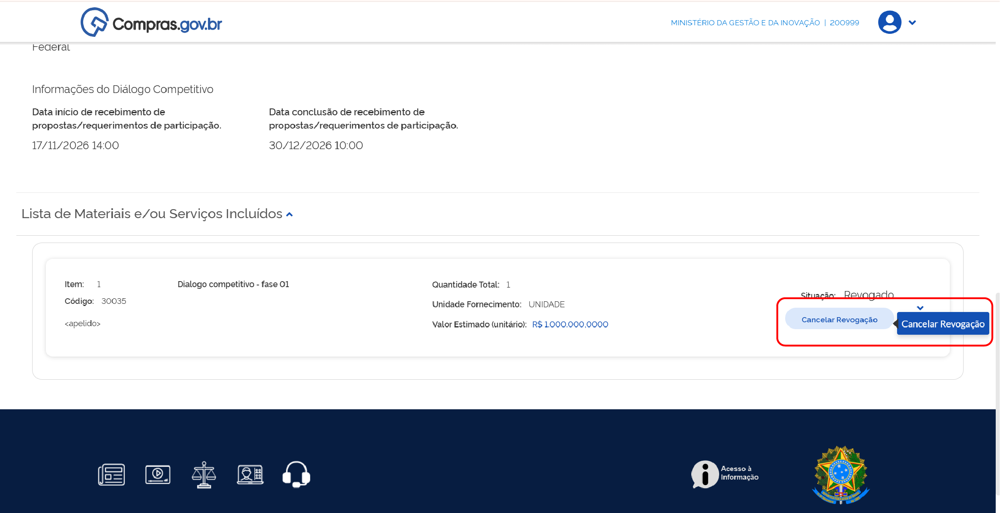

**Passo 03:** Preencha as informações destacadas na imagem abaixo e confirme.

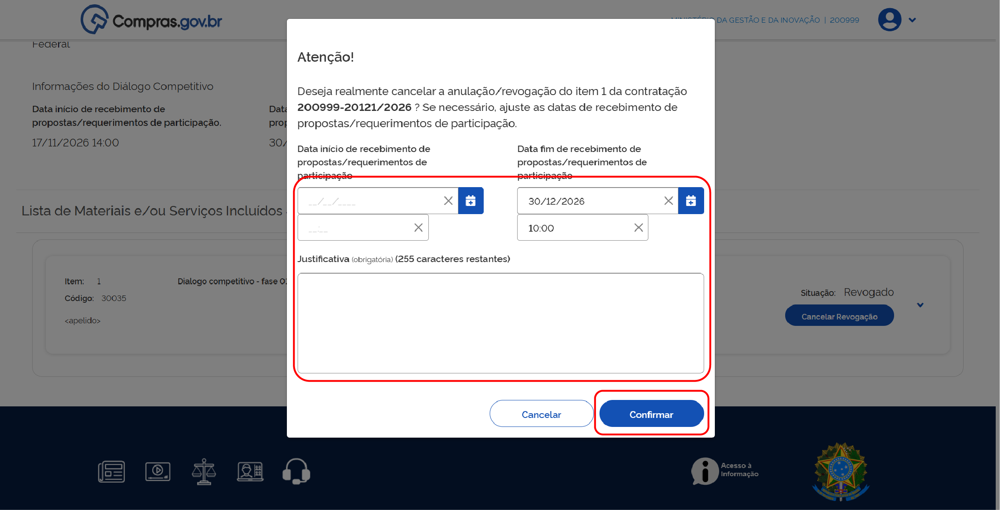

**Passo 04:** A revogação do item será cancelada.

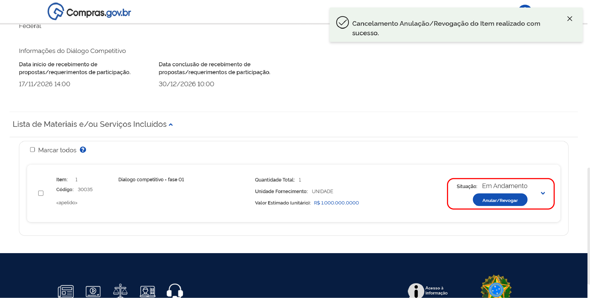

 

  <button onclick="window.print()" style="background-color: #0056b3; color: white; padding: 10px 20px; border: none; border-radius: 5px; font-size: 16px; cursor: pointer; box-shadow: 0 2px 4px rgba(0,0,0,0.2);">
    🖨️ Imprimir ou baixar esta página
  </button>

