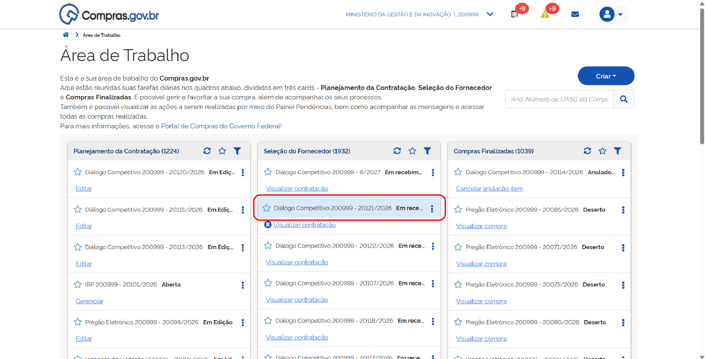
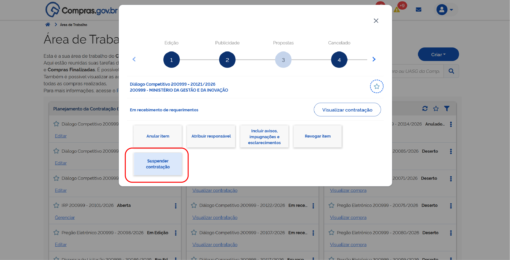
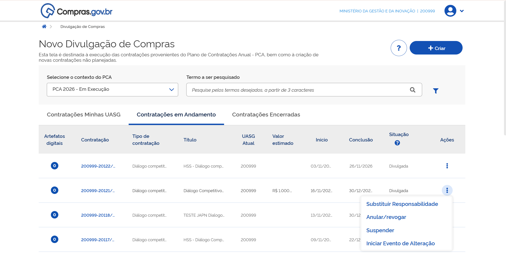
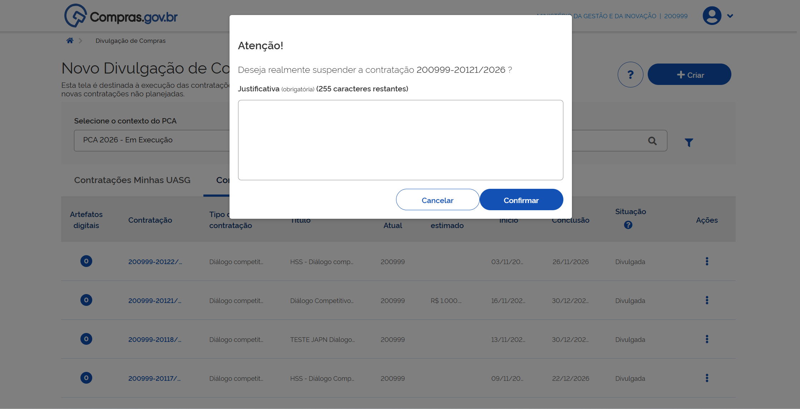
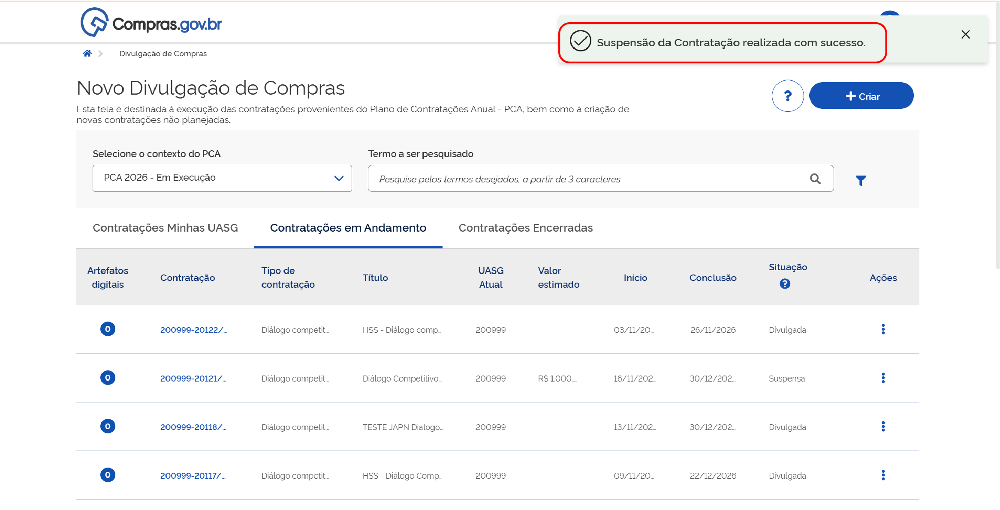
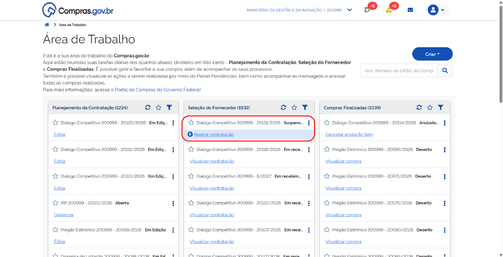
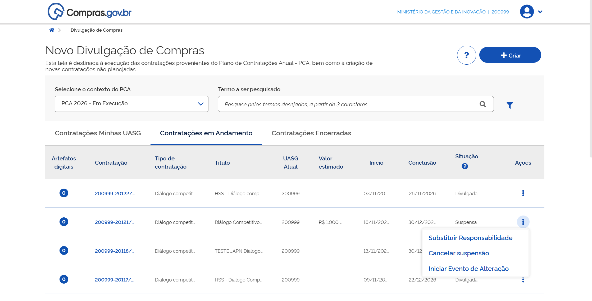
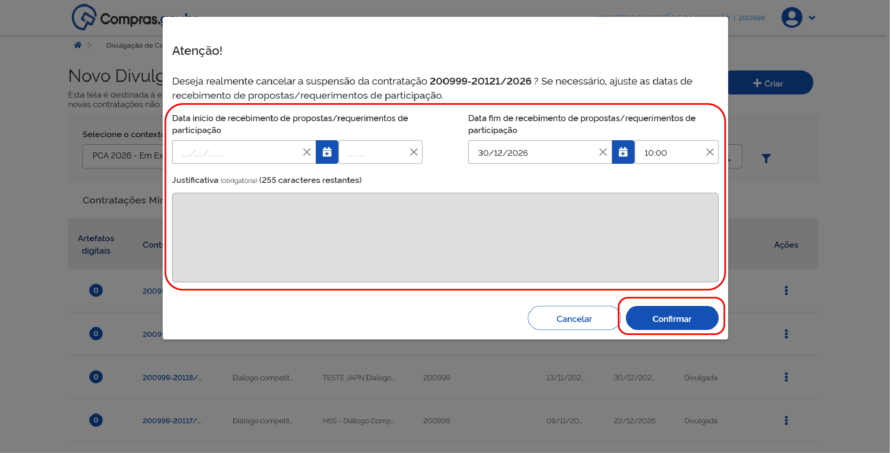
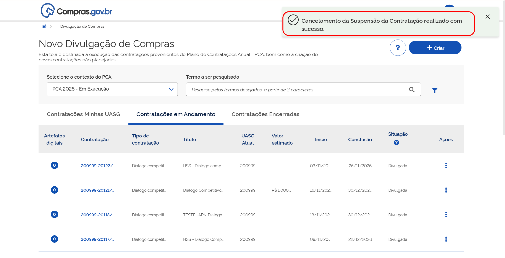

  Tamanho do texto:
  <button onclick="diminuirFonte()" title="Diminuir texto" style="padding: 6px 12px; font-weight: bold; cursor: pointer; border: 1px solid #ccc; border-radius: 4px; background: #f8f9fa;">A-</button>
  <button onclick="resetarFonte()" title="Tamanho normal" style="padding: 6px 12px; font-weight: bold; cursor: pointer; border: 1px solid #ccc; border-radius: 4px; background: #f8f9fa;">A</button>
  <button onclick="aumentarFonte()" title="Aumentar texto" style="padding: 6px 12px; font-weight: bold; cursor: pointer; border: 1px solid #ccc; border-radius: 4px; background: #f8f9fa;">A+</button>
  <button onclick="window.print()" style="background-color: #0056b3; color: white; padding: 6px 16px; border: none; border-radius: 5px; font-size: 14px; cursor: pointer; box-shadow: 0 2px 4px rgba(0,0,0,0.2); margin-left: 10px;">
    🖨️ Imprimir ou baixar esta página
  </button>

# 5. SUSPENSÃO E REABERTURA DA CONTRATAÇÃO

Nesta seção, você confere como suspender uma contratação divulgada e, posteriormente, cancelar a suspensão para agendar sua reabertura.

## Suspender contratação

**Passo 01:** Para suspender a contratação, localize sua contratação na **Área de Trabalho do usuário Governo** e clique sobre o número que a identifica.

**Passo 02:** Selecione a opção “Suspender contratação”.

**Passo 03:** Você será redirecionado para a página inicial do **Novo Divulgação de Compras**. Na contratação desejada, clique no menu lateral e selecione a opção “Suspender”.

**Passo 04:** Preencha o campo de justificativa e confirme.

A contratação foi suspensa.

---

## Cancelar suspensão e reabrir contratação

**Passo 01:** Para cancelar a suspensão da contratação, localize-a na **Área de Trabalho do usuário Governo** e clique sobre “Reabrir contratação”.

**Passo 02:** Você será redirecionado para a página inicial do **Novo Divulgação de Compras**, onde há uma lista de contratações. Ao lado da contratação desejada, clique no menu lateral e selecione a opção “Cancelar suspensão”.

**Passo 03:** Preencha as novas datas do evento de contratação, a justificativa para reabertura e confirme.

A suspensão foi cancelada e a reabertura foi agendada.

!!! note "Nota"
    **Nota:** Este manual será expandido com o lançamento das Fases II e III.

 

  <button onclick="window.print()" style="background-color: #0056b3; color: white; padding: 10px 20px; border: none; border-radius: 5px; font-size: 16px; cursor: pointer; box-shadow: 0 2px 4px rgba(0,0,0,0.2);">
    🖨️ Imprimir ou baixar esta página
  </button>

