

  Tamanho do texto:
  <button onclick="diminuirFonte()" title="Diminuir texto" style="padding: 6px 12px; font-weight: bold; cursor: pointer; border: 1px solid #ccc; border-radius: 4px; background: #f8f9fa;">A-</button>
  <button onclick="resetarFonte()" title="Tamanho normal" style="padding: 6px 12px; font-weight: bold; cursor: pointer; border: 1px solid #ccc; border-radius: 4px; background: #f8f9fa;">A</button>
  <button onclick="aumentarFonte()" title="Aumentar texto" style="padding: 6px 12px; font-weight: bold; cursor: pointer; border: 1px solid #ccc; border-radius: 4px; background: #f8f9fa;">A+</button>
  <button onclick="window.print()" style="background-color: #0056b3; color: white; padding: 6px 16px; border: none; border-radius: 5px; font-size: 14px; cursor: pointer; box-shadow: 0 2px 4px rgba(0,0,0,0.2); margin-left: 10px;">
    🖨️ Imprimir ou baixar esta página
  </button>

PÚBLICO-ALVO: ÓRGÃOS PÚBLICOS (USUÁRIO GOVERNO)

# Como realizar um Diálogo Competitivo no Novo Divulgação de Compras

## O que é o diálogo competitivo?

O diálogo competitivo é uma modalidade de licitação em que a Administração Pública conversa com participantes pré-selecionados para identificar ou desenvolver soluções que atendam a uma necessidade. Por isso, essa modalidade de contratação trata de apenas um item. Depois de encerrar o diálogo, a Administração abre a fase competitiva, em que os participantes pré-selecionados apresentam suas propostas finais.

É possível realizar uma contratação na modalidade diálogo competitivo a partir de um processo já previsto no Planejamento e Gerenciamento de Contratações (PGC) ou criar um processo de compra. Este tutorial mostra o passo a passo de como cadastrar e divulgar a **Fase I – Pré-seleção** no Novo Divulgação de Compras (Novo DC).

## Por onde começar?

* Se você precisa abrir um diálogo competitivo do zero no **Novo Divulgação de Compras (Novo DC)**, comece pela **Primeira Etapa** ([1. Criar a contratação no Novo DC](01-criar-contratacao.md)).
* Se a contratação já estiver prevista no **Planejamento e Gerenciamento das Contratações (PGC)**, vá direto para a **Segunda Etapa** ([2. Preencher dados e divulgar a contratação](02-divulgar-contratacao.md)).

!!! note "Nota"
    Este manual contempla os procedimentos da **Fase I – Pré-seleção** e será expandido futuramente com o lançamento das Fases II e III.

---

Formatos de Visualização

Você pode acessar as etapas específicas que quer consultar ou ver o manual completo, com todas as seções. Para isso, selecione o que quer ler no menu ao lado ou abaixo. Você também pode baixar ou imprimir cada uma dessas páginas ou o manual completo.

* **Primeira Etapa – Criar a contratação:**
    * [1. Criar a contratação no Novo DC](01-criar-contratacao.md)

* **Segunda Etapa – Divulgar a contratação:**
    * [2. Preencher dados e divulgar a contratação](02-divulgar-contratacao.md)

* **Outras ações na contratação:**
    * [3. Avisos, impugnações e esclarecimentos](03-avisos-impugnacoes-esclarecimentos.md)
    * [4. Anulação e revogação de item](04-anulacao-e-revogacao.md)
    * [5. Suspensão e reabertura da contratação](05-suspensao-e-reabertura.md)

* **Página única:**
    * [Todo o material em uma tela](manual-completo.md)

# 1. CRIAR A CONTRATAÇÃO NO NOVO DC

## Fase I – Pré-seleção | Primeira Etapa: Criar a contratação

Siga os passos abaixo caso precise iniciar um processo de contratação na modalidade Diálogo Competitivo diretamente no **Novo Divulgação de Compras (Novo DC)**. Se a contratação já estiver prevista no Planejamento e Gerenciamento das Contratações (PGC), avance diretamente para a **Segunda Etapa**.

**Passo 1:** Acesse o [Portal de Compras do Governo Federal](https://www.gov.br/compras/pt-br) e clique em “Acesso ao Sistema”.

**Passo 2:** Escolha o perfil **Governo** e clique em “Entrar com Gov.br”.

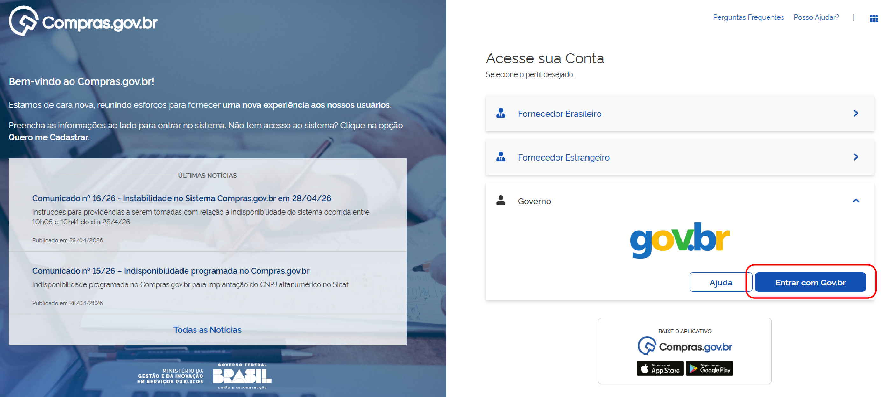

**Passo 3:** Na área de trabalho do usuário Governo, clique em “Novo Divulgação de Compras”.

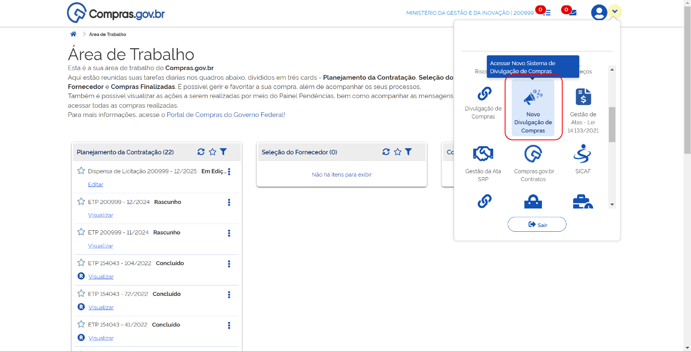

**Passo 4:** Clique em “+Criar”.

**Passo 5:** Preencha todas as informações relacionadas ao processo e clique em “Concluir”.

 

# 2. PREENCHER DADOS E DIVULGAR A CONTRATAÇÃO

## Fase I – Pré-seleção | Segunda Etapa: Divulgar a contratação

### Como preencher dados da contratação

**Passo 6:** Encontre a contratação desejada na aba **Contratações Minhas Uasg**. Em seguida, clique em “Editar”.

**Passo 7:** Na aba **Dados Básicos da Contratação**, preencha o número do processo e o número de controle interno da UASG. No **Tipo de contratação**, escolha a modalidade de licitação “Diálogo Competitivo – Fase de pré-seleção”.

!!! warning "Atenção"
    O número de controle interno da UASG permite que cada órgão controle seus processos, registrado no sistema para melhor rastreabilidade. O preenchimento desse número é facultativo.

**Passo 8:** Para definir o **Fundamento legal da contratação**, clique no ícone de lápis.

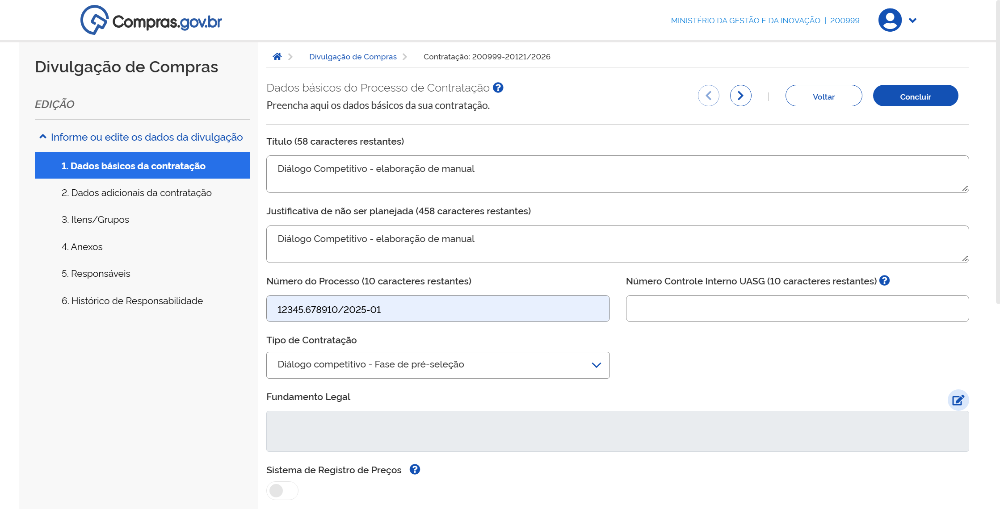

Navegue pela lista de fundamentos legais disponíveis. Quando encontrar a opção adequada, clique sobre o texto e, em seguida, clique em “Salvar”.

**Passo 9:** Caso sua contratação seja internacional, indique isso no campo correspondente. Edite ou preencha os demais campos conforme a necessidade.

**Passo 10:** Na aba **Dados adicionais da contratação**, preencha os dados do empenho para a publicação no Diário Oficial da União. Se necessário, consulte os dados de seu órgão para preencher corretamente as informações.

**Passo 11:** Caso o órgão ou entidade tenha processo eletrônico, selecione “Sim” e informe o endereço do processo eletrônico referente à contratação. Selecione “Não” se o processo não for eletrônico e preencha o campo de justificativa.

**Passo 12:** Preencha o **Tipo de recurso**, que poderá ser “Internacional”, “Federal”, “Distrital”, “Estadual” ou “Municipal”.

**Passo 13:** Informe a **data início** e a **data fim** de recebimento de requerimentos de participação. Indique também se haverá prêmio ou remuneração.

---

### Inclusão de itens na contratação

**Passo 14:** Na aba **Itens/Grupos**, clique em “+Adicionar” para incluir o item da contratação diretamente do Catálogo integrado ao Novo DC.

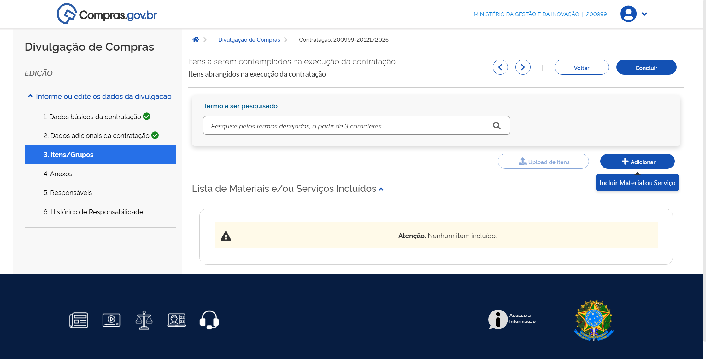

**Passo 15:** Pesquise pelo item “Diálogo Competitivo – fase I” e clique em adicionar.

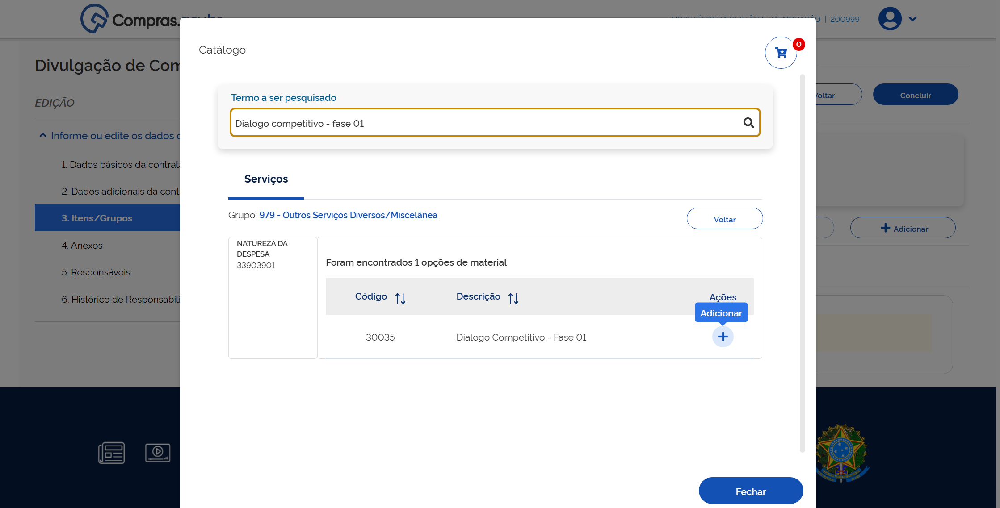

**Passo 16:** Incluir o valor unitário é opcional. Para isso, informe se é necessário e clique em “Salvar”.

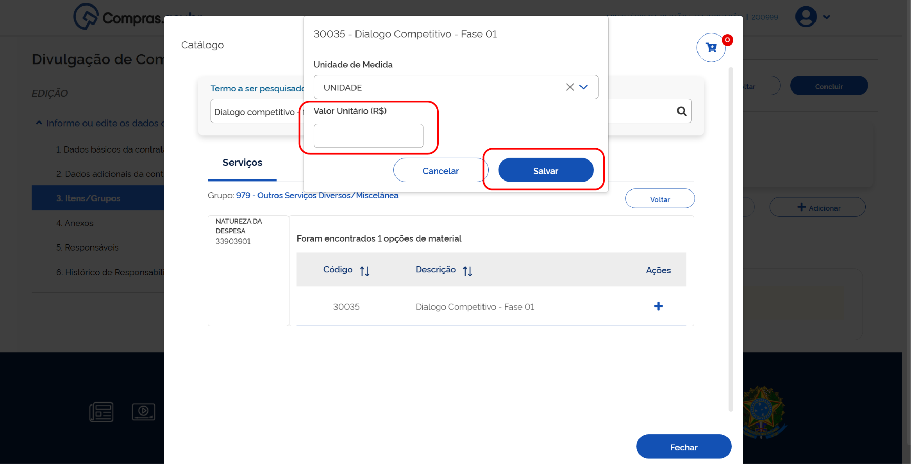

**Passo 17:** Depois de inserir o item, clique no carrinho localizado no canto superior direito. Selecione a opção “Adicionar itens no DC”. Confirme a inclusão do item no carrinho.

**Passo 18:** Para prosseguir com a configuração do item de sua licitação, clique em “Expandir”.

**Passo 19:** Preencha os campos adicionais conforme necessário.

---

### Inclusão de anexos e artefatos vinculados

**Passo 20:** Na aba **Anexos**, clique em “+Vincular” para vincular artefatos digitais da contratação ou documentos complementares.

**Passo 21:** Selecione o tipo de artefato que deseja pesquisar.

**Passo 22:** Selecione o documento e clique em “Vincular”.

**Passo 23:** Para anexar outros documentos, clique em “+Anexar”.

**Passo 24:** Selecione o tipo de anexo que deseja pesquisar.

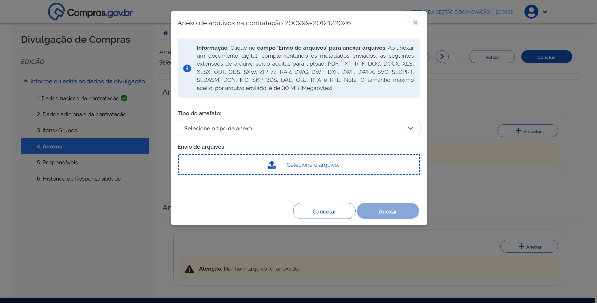

**Passo 25:** Selecione o arquivo e clique em “Anexar”.

---

### Inclusão de responsáveis pela contratação

**Passo 26:** Para adicionar informações dos responsáveis pela contratação, clique em “+Adicionar” na aba **Responsáveis**.

**Passo 27:** Insira o CPF e o e-mail do responsável, selecione seu **Cargo/Função** e clique em “Adicionar”.

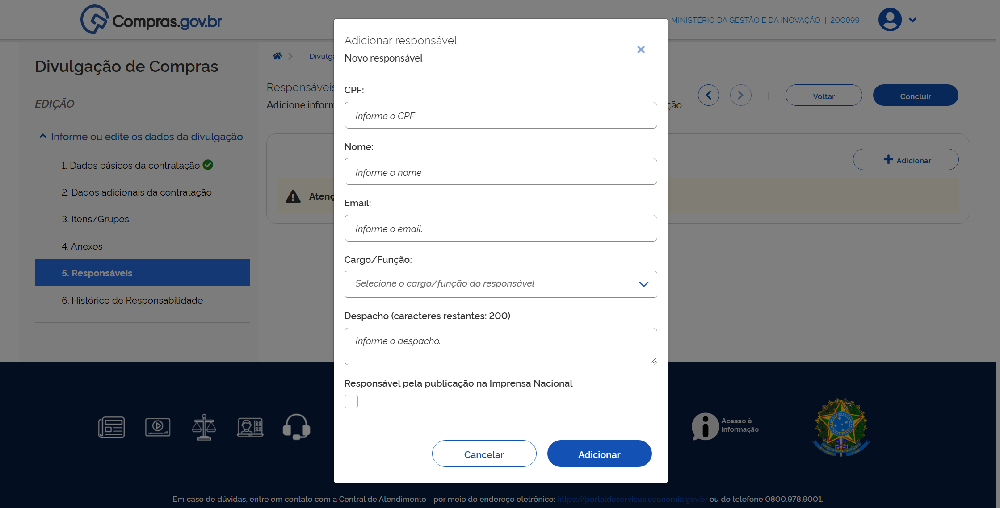

!!! warning "Atenção"
    Entre os responsáveis é obrigatório relacionar o servidor que realizará a publicação na Imprensa Nacional. Essa pessoa deverá ser cadastrada para isso na Imprensa Nacional.

!!! warning "Atenção"
    Devem ser inseridos, no mínimo, os responsáveis abaixo:

    * Dois membros de comissão de contratação;
    * Presidente da comissão.

**Passo 28:** Depois de preencher essas informações, clique em “Concluir” para que a contratação seja encaminhada para publicação.

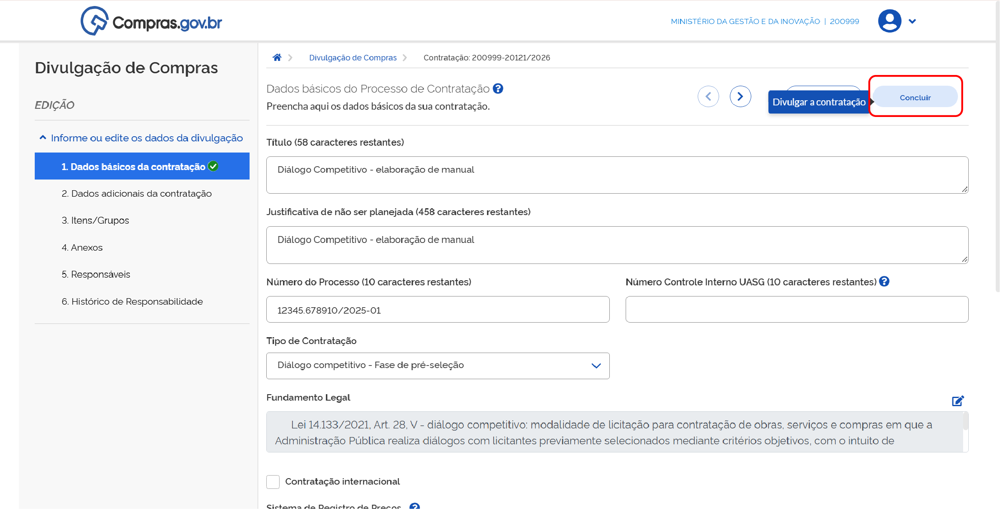

**Passo 29:** Para visualizar a prévia da matéria do Diário Oficial da União, clique em “Visualizar prévia”.

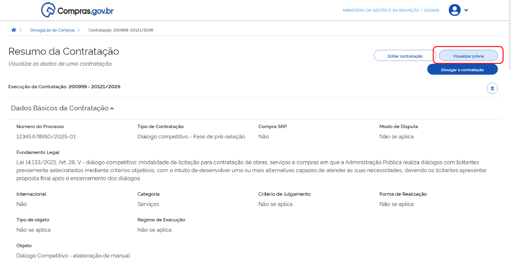

Verifique os dados apresentados.

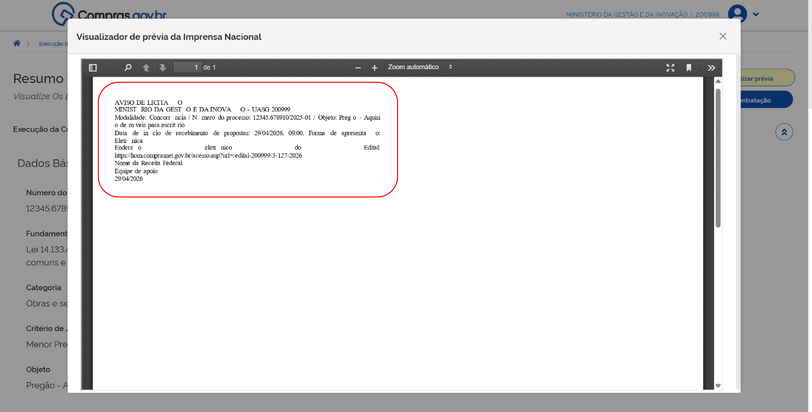

**Passo 30:** Para divulgar o certame, clique em “Divulgar a contratação” na página de **Resumo da Contratação**.

A contratação será divulgada no Portal Nacional de Contratações Públicas (PNCP).

Sua contratação poderá receber requerimentos de participação conforme as datas especificadas na aba **Dados básicos da contratação**.

 

# 3. AVISOS, IMPUGNAÇÕES E ESCLARECIMENTOS

Após a divulgação da contratação, é possível registrar avisos, impugnações e pedidos de esclarecimentos diretamente pelo sistema.

## Avisos

**Passo 01:** Para publicar avisos sobre o evento de contratação, localize-a na **Área de Trabalho do usuário Governo** e clique sobre o número que a identifica.

**Passo 02:** Selecione a opção “Incluir avisos, impugnações e esclarecimentos”.

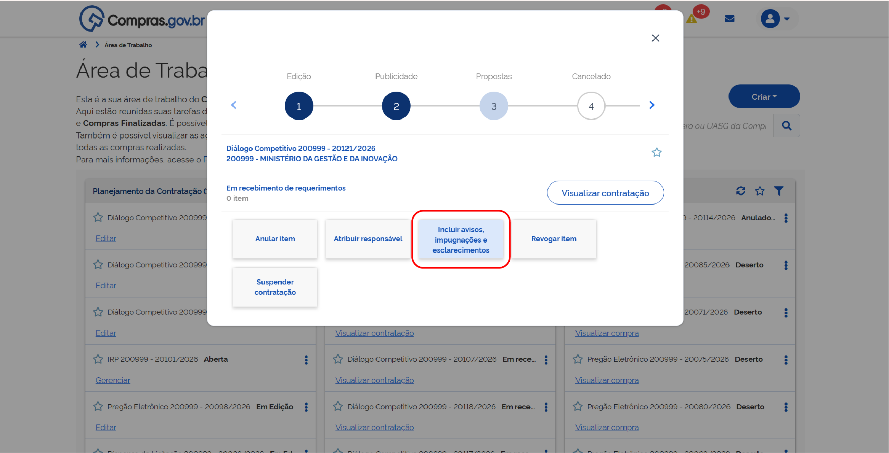

**Passo 03:** Na aba **Avisos**, clique em “Incluir Aviso”.

**Passo 04:** Preencha o campo destacado na imagem abaixo e clique em **Confirmar**.

!!! warning "Atenção"
   Avisos não podem ser excluídos.

---

## Impugnações

**Passo 01:** Para publicar impugnações relativas ao evento de contratação, localize-a na **Área de Trabalho do usuário Governo** e clique sobre o número que a identifica.

**Passo 02:** Selecione a opção “Incluir avisos, impugnações e esclarecimentos”.

**Passo 03:** Na aba **Impugnações**, clique em “Incluir impugnação”.

**Passo 04:** Preencha os campos destacados na imagem abaixo e clique em **Confirmar**.

!!! warning "Atenção"
    Impugnações não podem ser excluídas.

---

## Esclarecimentos

**Passo 01:** Para publicar pedidos de esclarecimentos sobre a contratação, localize-a na **Área de Trabalho do usuário Governo** e clique sobre o número que a identifica.

**Passo 02:** Selecione a opção “Incluir avisos, impugnações e esclarecimentos”.

**Passo 03:** Na aba **Esclarecimentos**, clique em “Incluir esclarecimento”.

**Passo 04:** Preencha o campo destacado na imagem abaixo e clique em **Confirmar**.

!!! warning "Atenção"
    Esclarecimentos não podem ser excluídos.

 

# 4. ANULAÇÃO E REVOGAÇÃO DE ITEM

Nesta seção, você confere como realizar a anulação ou a revogação do item da contratação, bem como os procedimentos para cancelar essas ações quando necessário.

## Anular item

**Passo 01:** Para anular o item da contratação, localize-a na **Área de Trabalho do usuário Governo** e clique sobre o número que a identifica.

**Passo 02:** Selecione a opção “Anular item”.

**Passo 03:** Na tela de anular ou revogar itens, localize o item da contratação

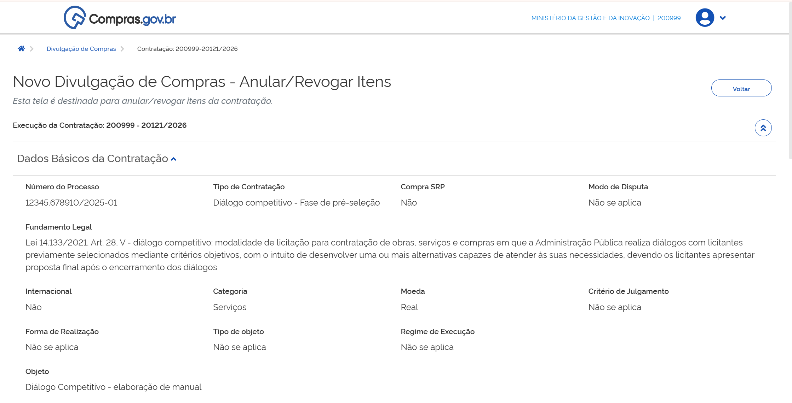

e clique no botão “Anular/revogar”.

**Passo 04:** Escolha a opção “Anulação de item”.

**Passo 05:** Preencha a justificativa e confirme a opção.

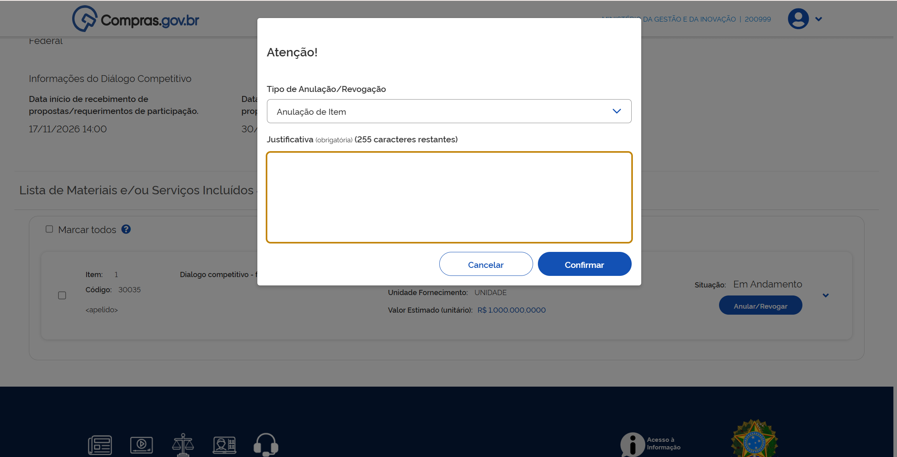

O item será anulado.

!!! warning "Atenção"
    Por ser uma contratação de único item, o procedimento de anulação do item resultará na anulação do processo de contratação.

---

## Cancelamento da anulação

**Passo 01:** Para cancelar a anulação do item, localize a contratação na **Área de Trabalho do usuário Governo** e clique sobre “Cancelar anulação de item”.

**Passo 02:** Na tela de anular ou revogar itens, localize o item da contratação

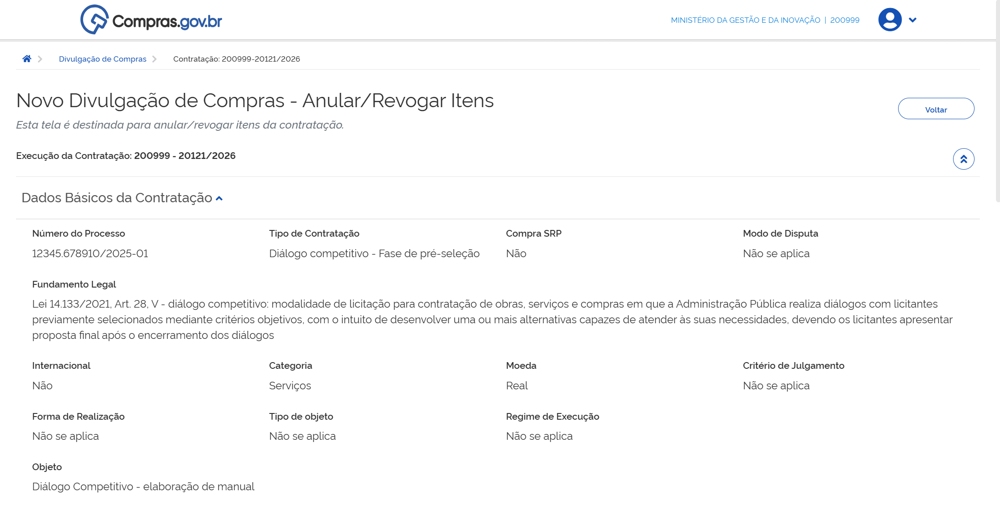

e clique em “Cancelar anulação”.

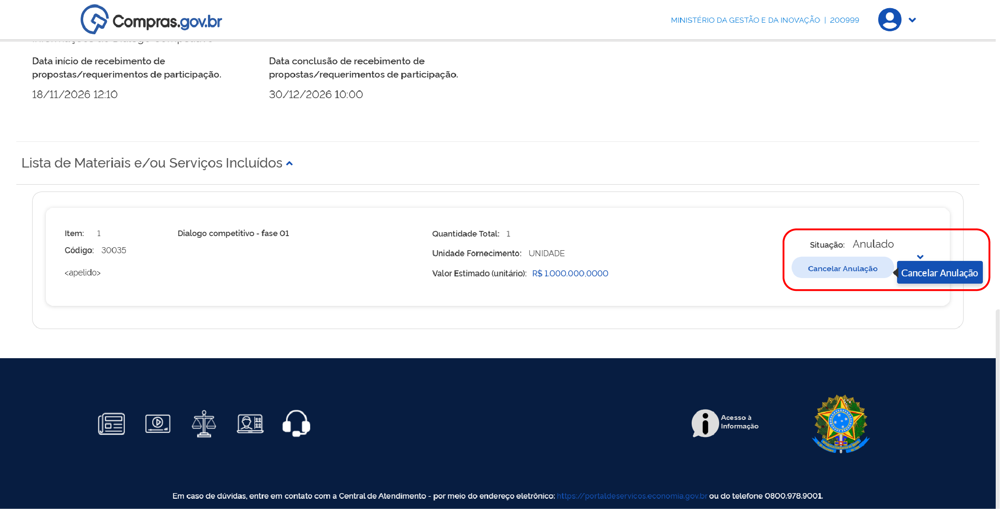

**Passo 03:** Preencha as informações destacadas na imagem abaixo e confirme.

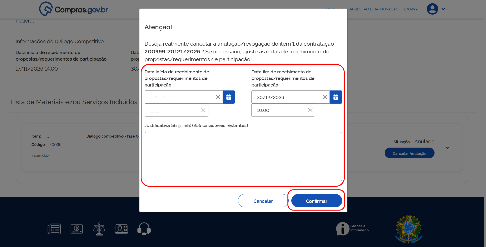

A anulação do item será cancelada.

---

## Revogar item

**Passo 01:** Para revogar o item, localize a contratação na **Área de Trabalho do usuário Governo** e clique sobre o número que a identifica.

**Passo 02:** Selecione a opção “Revogar item”.

**Passo 03:** Na tela de anular ou revogar itens, localize o item da contratação

e clique no botão “Anular/revogar”.

**Passo 04:** Selecione a opção “Revogação de item”.

**Passo 05:** Preencha a justificativa e confirme a opção.

O item será revogado.

!!! warning "Atenção"
    Por ser uma contratação de único item, o procedimento de revogação do item resultará na revogação do processo de contratação.

---

## Cancelamento de revogação

**Passo 01:** Para cancelar a revogação do item, localize sua contratação na **Área de Trabalho do usuário Governo** e clique sobre “Cancelar revogação de item”.

**Passo 02:** Na tela de anular ou revogar itens, localize o item da contratação

e acione o botão “Cancelar revogação”.

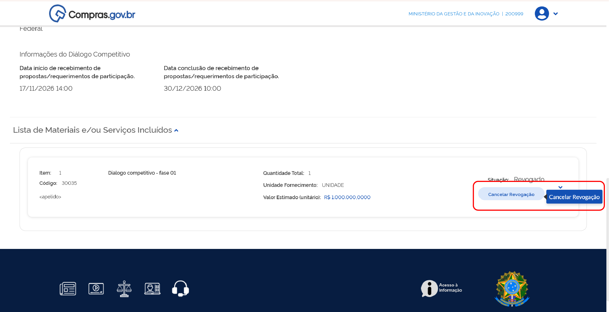

**Passo 03:** Preencha as informações destacadas na imagem abaixo e confirme.

**Passo 04:** A revogação do item será cancelada.

 

# 5. SUSPENSÃO E REABERTURA DA CONTRATAÇÃO

Nesta seção, você confere como suspender uma contratação divulgada e, posteriormente, cancelar a suspensão para agendar sua reabertura.

## Suspender contratação

**Passo 01:** Para suspender a contratação, localize sua contratação na **Área de Trabalho do usuário Governo** e clique sobre o número que a identifica.

**Passo 02:** Selecione a opção “Suspender contratação”.

**Passo 03:** Você será redirecionado para a página inicial do **Novo Divulgação de Compras**. Na contratação desejada, clique no menu lateral e selecione a opção “Suspender”.

**Passo 04:** Preencha o campo de justificativa e confirme.

A contratação foi suspensa.

---

## Cancelar suspensão e reabrir contratação

**Passo 01:** Para cancelar a suspensão da contratação, localize-a na **Área de Trabalho do usuário Governo** e clique sobre “Reabrir contratação”.

**Passo 02:** Você será redirecionado para a página inicial do **Novo Divulgação de Compras**, onde há uma lista de contratações. Ao lado da contratação desejada, clique no menu lateral e selecione a opção “Cancelar suspensão”.

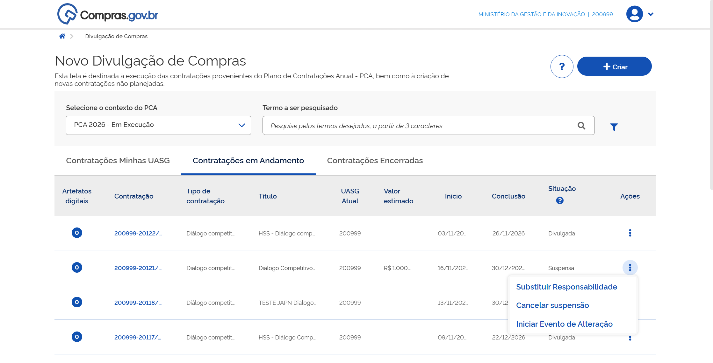

**Passo 03:** Preencha as novas datas do evento de contratação, a justificativa para reabertura e confirme.

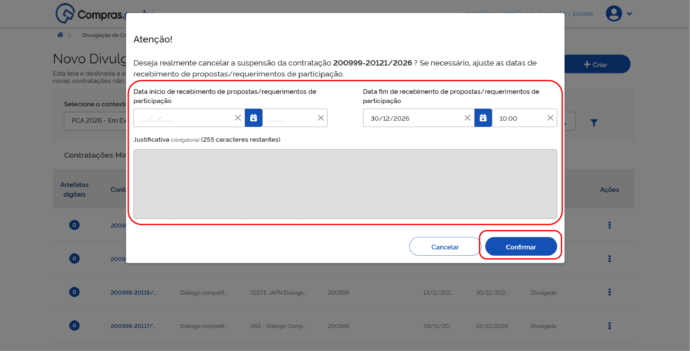

A suspensão foi cancelada e a reabertura foi agendada.

!!! note "Nota"
    Este manual será expandido com o lançamento das Fases II e III do processo de implantação do diálogo competitivo no sistema Compras.gov.br.

 

  <button onclick="window.print()" style="background-color: #0056b3; color: white; padding: 10px 20px; border: none; border-radius: 5px; font-size: 16px; cursor: pointer; box-shadow: 0 2px 4px rgba(0,0,0,0.2);">
    🖨️ Imprimir ou baixar esta página
  </button>

